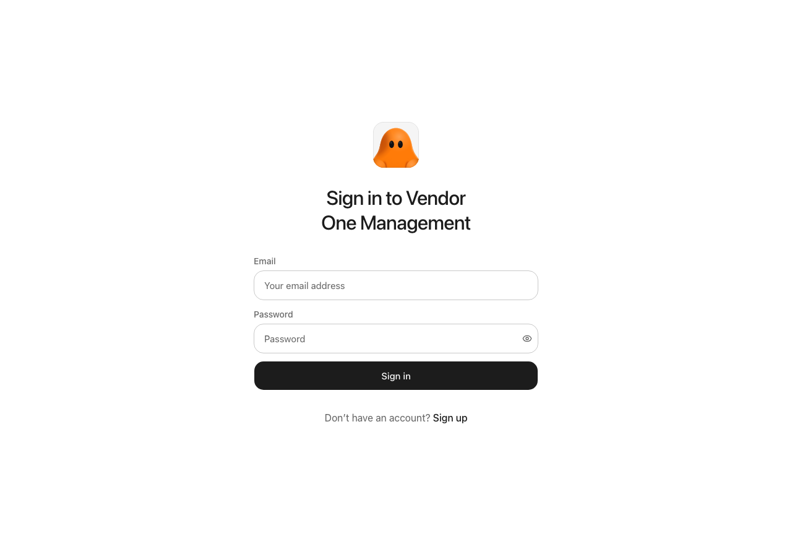
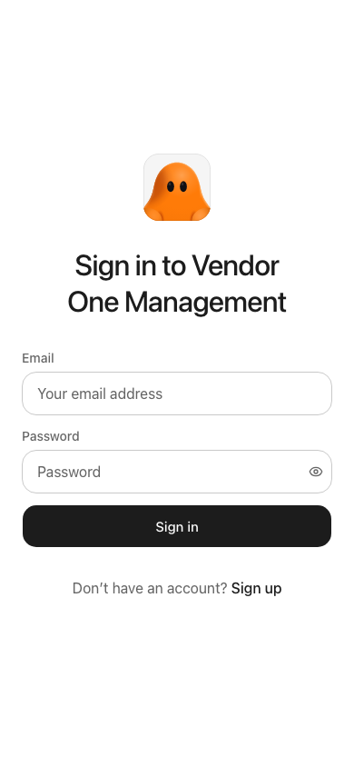

# Product branding

The product display name is **Vendor One Management** across web, desktop,
mobile, shared pages, transactional email, notification copy, marketing and docs.
The mascot and icon artwork stay the same.

## Retained Rakazo references

These are deliberately retained for compatibility or attribution:

- Package names and imports (`@rakazo/*`), source filenames, classes, native module
  names, CSS selectors and test markers.
- Environment variables, API routes, database names, export formats, HTTP headers,
  URL schemes, bundle/application IDs, storage keys and existing desktop profiles.
- Release download filenames and signature formats. The desktop display name changes;
  executable and macOS bundle filenames and existing profile folders stay compatible.
- Existing public domains, email addresses, upstream repository links and community
  links. Renaming the product does not provision replacement services or domains.
- Copyright, author attribution, license and upstream privacy/terms references.
  These remain the upstream legal documents, rather than inventing new legal terms.
- Internal source comments, developer instructions, historical changelog entries
  and protocol/prompt markers such as `RakazoPage` and `Rakazo-owned`.
- Shared `packages/i18n/locales/*/messages.po` catalogs and historical translation
  helper dictionaries in `apps/web/scripts/translations-*.json`. Feature PRs do not
  edit these catalogs; the existing translation workflow updates them. The normal
  web build extracts its template so renamed source messages render in English
  until translated. Native and transactional-email string tables are updated here.

The original SVG wordmark URL is preserved, with new visible lettering. Social
preview images and the README hero have been regenerated with the new name.

## Visual review

The sign-in screen was checked at desktop and mobile widths using anonymous,
offline fixture responses. The longer heading wraps without clipping; controls
and the single primary action remain unchanged. Native app installation and
signed desktop packaging were not exercised locally.

